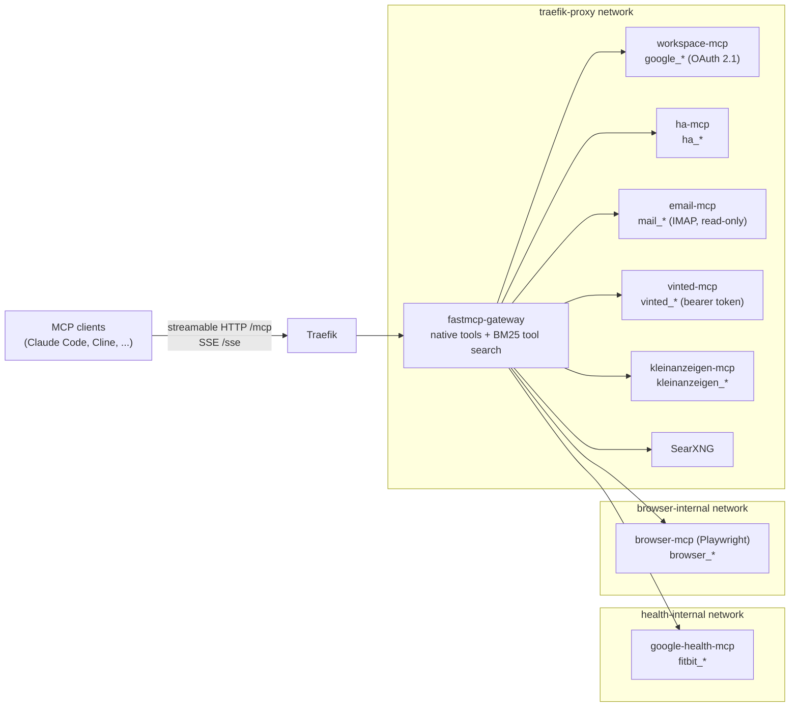

# FastMCP Gateway

A self-hosted [Model Context Protocol](https://modelcontextprotocol.io) gateway that gives AI agents
(Claude Code, Claude Desktop, Cline, custom harnesses) a single endpoint for web search, scraping,
documentation lookup, Google Workspace, email, smart home, marketplaces, a headless browser and music
playback.

Built on [FastMCP](https://gofastmcp.com) 4. The gateway serves a few tools of its own and mounts
seven MCP sub-servers via proxy composition. Each sub-server runs in its own container, and agents
see one namespaced tool catalog.

## Architecture



### Native tools

| Tool | Description |
|---|---|
| `searxng_search` | Web search via a self-hosted SearXNG instance |
| `firecrawl_scrape` | Page scraping to Markdown via the Firecrawl API |
| `context7_docs` | Up-to-date library documentation via Context7 |
| `music_play` / `music_control` | Plays music on a home speaker: Plex + headless Plexamp first, Spotify Connect as fallback |

### Mounted sub-servers

| Namespace | Upstream | Notes |
|---|---|---|
| `google_*` | [workspace-mcp](https://github.com/taylorwilsdon/google_workspace_mcp) | Gmail, Calendar, Tasks, Drive, Docs, ... in OAuth 2.1 mode |
| `ha_*` | [ha-mcp](https://github.com/homeassistant-ai/ha-mcp) | Home Assistant |
| `mail_*` | [mcp-email-server](https://github.com/wh1isper/mcp-email-server) | IMAP, read-only, multiple accounts |
| `fitbit_*` | google-health-mcp-unofficial | Google Health / Fitbit data, read-only scopes |
| `vinted_*` | @googlarz/vinted-client | Vinted marketplace search |
| `kleinanzeigen_*` | [kleinanzeigen-mcp](https://github.com/Samxel/kleinanzeigen-mcp) | Kleinanzeigen marketplace search |
| `browser_*` | [Playwright MCP](https://github.com/microsoft/playwright-mcp) | Headless Chromium, isolated per session |

If a sub-server is unreachable at startup, the gateway logs the error and starts without it.

## Design notes

**Tool search instead of a huge tool list.** The full catalog has well over a hundred tools, which
fills an agent's context and makes tool selection worse. A `BM25SearchTransform` lists only an
allow-list of core tools directly. Agents find everything else with `search_tools` and run it with
`call_tool`.

**Network isolation for sub-servers without authentication.** Several upstream servers ship without
any auth. None of them get Traefik labels:

- `google-health-mcp` and `browser-mcp` each sit on a dedicated Docker network shared only with the
  gateway. The health server publishes a loopback-only port for its one-time OAuth flow.
- [`scripts/browser-firewall.sh`](scripts/browser-firewall.sh) restricts the headless browser's
  egress to the public internet with iptables and nftables. This blocks connections to the LAN,
  Tailscale/CGNAT ranges, the Docker host and the gateway itself, so a prompt-injected page cannot
  use the browser to reach internal services.
- `vinted-mcp` requires a bearer token. The email server is configured as IMAP-only and read-only.

**Protocol version pinning.** FastMCP 4 speaks the 2026 MCP protocol by default. The Node-based
sub-servers (MCP SDK 1.x) reject it, so those proxies are created with `mode="legacy"` to pin the
older handshake.

**OAuth 2.1 against Google Workspace.** The gateway authenticates to workspace-mcp as an OAuth 2.1
client (PKCE + dynamic client registration). Its tokens persist in a file store on a shared volume,
so the one-time consent survives restarts. A small client-side patch
([`app/oauth_client_scope_patch.py`](app/oauth_client_scope_patch.py)) works around the MCP SDK
rejecting the scope set that Google grants.

**Reproducible images.** Third-party images are pinned by digest, and npm/PyPI/git sources by
version or commit.

## Security model

The gateway is built for a single user. Anyone who can call `/mcp` can use every mounted tool,
including sending email and controlling Home Assistant, so access is limited in two ways:

- **Bearer token.** With `GATEWAY_TOKEN` set, `/mcp`, `/sse` and `/messages` reject requests without
  `Authorization: Bearer <token>` ([`app/auth.py`](app/auth.py)). `/health` stays public. With an
  empty token the gateway logs a warning and accepts unauthenticated requests.
- **Network.** In my deployment the hostname resolves only inside the LAN and the Tailscale
  tailnet. The gateway is not reachable from the public internet.

Sub-servers never handle client authentication themselves. Each one is reachable only from the
gateway (see the design notes above).

## Setup

Requirements: Docker with Compose, and an external Docker network `traefik-proxy` with Traefik
attached.

```bash
cp .env.example .env                                     # domains, GATEWAY_TOKEN, API keys
cp email-mcp/config.toml.example email-mcp/config.toml   # IMAP accounts
# searxng/settings.yml: start from the default SearXNG settings and set secret_key
docker compose up -d --build
sudo scripts/browser-firewall.sh                          # once per boot
```

One-time OAuth flows:

- Google Workspace: [`workspace-mcp/SETUP.md`](workspace-mcp/SETUP.md)
- Google Health / Fitbit: [`google-health-mcp/SETUP.md`](google-health-mcp/SETUP.md)
- Spotify: `python3 scripts/spotify_auth.py`

Every backend is optional. Disable a sub-server with its `*_ENABLED` variable, e.g.
`HA_MCP_ENABLED=false` (see [`app/config.py`](app/config.py)). The music backends stay off while
their credentials are empty.

### Connecting a client

```bash
claude mcp add --transport http gateway https://mcp.example.com/mcp \
  --header "Authorization: Bearer $GATEWAY_TOKEN"
```

Streamable HTTP is served at `/mcp`, legacy SSE at `/sse` + `/messages`. `GET /health` reports which
sub-servers are mounted.

## Tests

Unit tests cover the auth middleware and the music tool (fake backends, no network). They run
inside the gateway container:

```bash
docker cp tests fastmcp-gateway:/tmp/gwtests
docker exec -w /app fastmcp-gateway python -m unittest discover -s /tmp/gwtests -v
```

## License

MIT, see [LICENSE](LICENSE).
